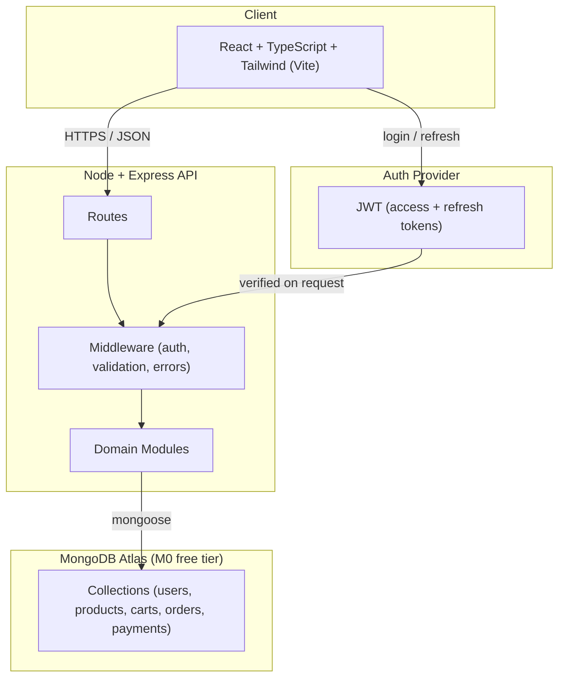

# ShopSphere Architecture

## System Diagram

Source: [`architecture.mmd`](./architecture.mmd) · Export: [`architecture.png`](./architecture.png)

The diagram shows the client, the API, MongoDB Atlas and the auth provider, and how a request flows from the browser through middleware into a domain module and on to its collection.

## Module Boundaries

Each module owns its collections and its endpoints. No module reads another module's collections directly; cross-module data goes through the owning module.

| Module | Owned collections | Base endpoint | Responsibility |
|--------|-------------------|---------------|----------------|
| Auth | `users`, `sessions` | `/api/auth` | Registration, login, token refresh, logout, current user |
| Catalog | `products`, `categories` | `/api/products`, `/api/categories` | Product and category listing, search, detail |
| Cart | `carts`, `cartitems` | `/api/cart` | Add/update/remove items, view cart |
| Orders | `orders`, `orderitems` | `/api/orders` | Checkout, order history, order status |
| Payments | `payments` | `/api/payments` | Payment intent, capture, refund, webhook |
| Admin | (none; acts through module services) | `/api/admin` | Product CRUD, order management, user management |

## Endpoint Summary

| Method | Path | Module | Access |
|--------|------|--------|--------|
| POST | `/api/auth/register` | Auth | Public |
| POST | `/api/auth/login` | Auth | Public |
| POST | `/api/auth/refresh` | Auth | Public (refresh token) |
| POST | `/api/auth/logout` | Auth | Authenticated |
| GET | `/api/auth/me` | Auth | Authenticated |
| GET | `/api/products` | Catalog | Public |
| GET | `/api/products/:id` | Catalog | Public |
| GET | `/api/categories` | Catalog | Public |
| GET | `/api/cart` | Cart | Authenticated |
| POST | `/api/cart/items` | Cart | Authenticated |
| PATCH | `/api/cart/items/:id` | Cart | Authenticated |
| DELETE | `/api/cart/items/:id` | Cart | Authenticated |
| POST | `/api/orders` | Orders | Authenticated |
| GET | `/api/orders` | Orders | Authenticated |
| GET | `/api/orders/:id` | Orders | Authenticated |
| POST | `/api/payments/intent` | Payments | Authenticated |
| POST | `/api/payments/webhook` | Payments | Provider signature |
| POST | `/api/admin/products` | Admin | Admin |
| PATCH | `/api/admin/orders/:id` | Admin | Admin |

## Decisions

Key architecture decisions are recorded as ADRs in [`docs/adr/`](./adr/).
