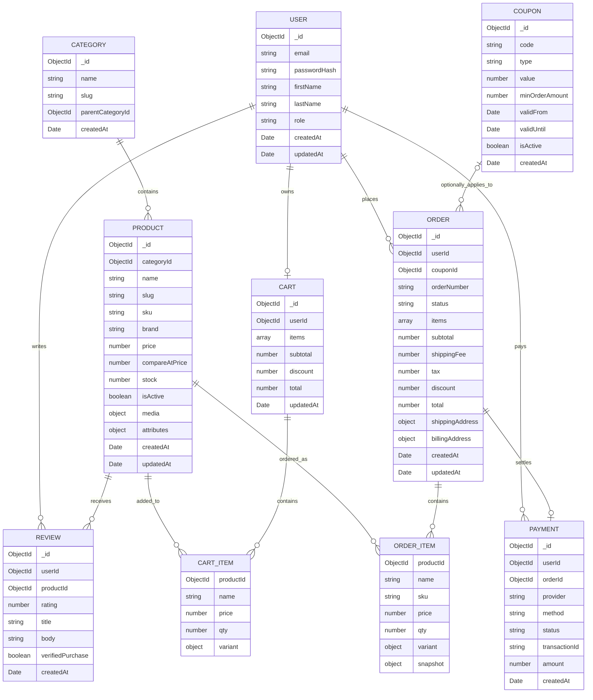
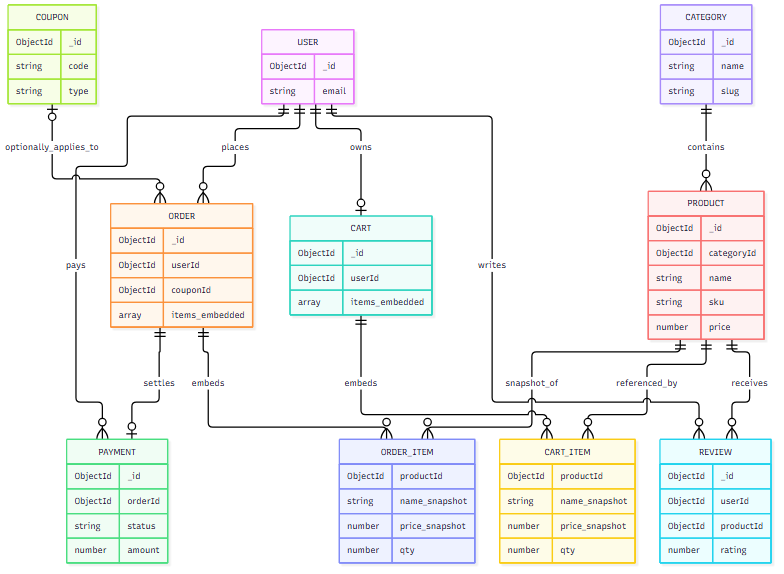

# ShopSphere Database Design

This document defines the MongoDB-backed data model for ShopSphere. The design favors normalized references for entities that are shared across the system and embeds volatile or frequently accessed subdocuments for read-heavy user flows.

## 1) ER Diagram and Reference vs. Embedding Decisions

### Reference vs. embedding decisions

- Use references for master data that must be queried independently or updated frequently:
  - `products.categoryId` -> `categories._id`
  - `carts.userId` -> `users._id`
  - `orders.userId` -> `users._id`
  - `reviews.userId` and `reviews.productId`
  - `payments.orderId` and `payments.userId`
  - `orders.couponId` -> `coupons._id`

- Embed for high-read, low-write, user-facing subdocuments:
  - `cart.items`: product summary + quantity + variant snapshot; fast to render cart page
  - `order.items`: historical product snapshot to preserve orders after product edits
  - `product.media`: catalog thumbnails / gallery data kept with product document
  - `product.attributes`: SKU metadata and filters
  - `order.shippingAddress` and `order.billingAddress`: stored with the order snapshot for accounting and audit

- Avoid embedding large, high-churn datasets that should be searched/filterable elsewhere:
  - product reviews are kept in a separate collection to allow rating aggregation and pagination
  - payment ledger remains separate to keep charge flows independent from order lifecycle updates

## 2) Collection Plans and Field Definitions

### users

| Field | Type | Required | Default | Notes |
|---|---|---:|---|---|
| `_id` | ObjectId | Yes | auto | Primary key |
| `email` | String | Yes | none | Unique, lowercased |
| `passwordHash` | String | Yes | none | Hashed using bcrypt/argon2 |
| `firstName` | String | No | "" | Display name part |
| `lastName` | String | No | "" | Display name part |
| `role` | String | Yes | `customer` | Enum: `customer`, `admin`, `seller` |
| `isActive` | Boolean | Yes | true | Soft disable support |
| `createdAt` | Date | Yes | `new Date()` | Audit |
| `updatedAt` | Date | Yes | `new Date()` | Audit |

### categories

| Field | Type | Required | Default | Notes |
|---|---|---:|---|---|
| `_id` | ObjectId | Yes | auto | Primary key |
| `name` | String | Yes | none | Category label |
| `slug` | String | Yes | none | URL-friendly, unique |
| `description` | String | No | "" | Marketing copy |
| `parentCategoryId` | ObjectId | No | null | Self-reference for nested categories |
| `isActive` | Boolean | Yes | true | Hide inactive categories |
| `createdAt` | Date | Yes | `new Date()` | Audit |
| `updatedAt` | Date | Yes | `new Date()` | Audit |

### products

| Field | Type | Required | Default | Notes |
|---|---|---:|---|---|
| `_id` | ObjectId | Yes | auto | Primary key |
| `categoryId` | ObjectId | Yes | none | Ref to categories |
| `name` | String | Yes | none | Product display name |
| `slug` | String | Yes | none | Unique, SEO URL |
| `sku` | String | Yes | none | Unique stock code |
| `brand` | String | No | "" | Product brand |
| `description` | String | No | "" | Product details |
| `price` | Number | Yes | 0 | Base selling price |
| `compareAtPrice` | Number | No | 0 | MSRP / old price |
| `currency` | String | Yes | `USD` | Currency code |
| `stock` | Number | Yes | 0 | Inventory available |
| `lowStockThreshold` | Number | No | 5 | Alert threshold |
| `isActive` | Boolean | Yes | true | Catalog visibility |
| `media` | Array | No | [] | Product images/videos |
| `attributes` | Object | No | {} | Filterable metadata |
| `ratingAverage` | Number | No | 0 | Computed value |
| `reviewCount` | Number | No | 0 | Computed value |
| `createdAt` | Date | Yes | `new Date()` | Audit |
| `updatedAt` | Date | Yes | `new Date()` | Audit |

### carts

| Field | Type | Required | Default | Notes |
|---|---|---:|---|---|
| `_id` | ObjectId | Yes | auto | Primary key |
| `userId` | ObjectId | Yes | none | User owner |
| `items` | Array | Yes | [] | Embedded cart items |
| `items[].productId` | ObjectId | Yes | none | Ref to product |
| `items[].name` | String | Yes | none | Snapshot of product name |
| `items[].price` | Number | Yes | 0 | Snapshot of current price |
| `items[].qty` | Number | Yes | 1 | Quantity |
| `items[].variant` | Object | No | {} | Size/color metadata |
| `subtotal` | Number | Yes | 0 | Before discounts |
| `discount` | Number | Yes | 0 | Coupon or promo value |
| `total` | Number | Yes | 0 | Final total |
| `updatedAt` | Date | Yes | `new Date()` | Audit |

### orders

| Field | Type | Required | Default | Notes |
|---|---|---:|---|---|
| `_id` | ObjectId | Yes | auto | Primary key |
| `userId` | ObjectId | Yes | none | Customer |
| `couponId` | ObjectId | No | null | Optional applied coupon |
| `orderNumber` | String | Yes | none | Human-friendly order number |
| `status` | String | Yes | `pending` | Enum: pending, paid, packed, shipped, delivered, cancelled |
| `items` | Array | Yes | [] | Embedded historical snapshot |
| `items[].productId` | ObjectId | Yes | none | Product ref |
| `items[].name` | String | Yes | none | Product name snapshot |
| `items[].sku` | String | Yes | none | SKU snapshot |
| `items[].price` | Number | Yes | 0 | Price at order time |
| `items[].qty` | Number | Yes | 1 | Purchase quantity |
| `items[].variant` | Object | No | {} | Variant snapshot |
| `subtotal` | Number | Yes | 0 | Order subtotal |
| `shippingFee` | Number | Yes | 0 | Delivery charge |
| `tax` | Number | Yes | 0 | Tax amount |
| `discount` | Number | Yes | 0 | Discount applied |
| `total` | Number | Yes | 0 | Final amount |
| `shippingAddress` | Object | Yes | {} | Shipping destination |
| `billingAddress` | Object | No | null | Billing details |
| `createdAt` | Date | Yes | `new Date()` | Audit |
| `updatedAt` | Date | Yes | `new Date()` | Audit |

### payments

| Field | Type | Required | Default | Notes |
|---|---|---:|---|---|
| `_id` | ObjectId | Yes | auto | Primary key |
| `userId` | ObjectId | Yes | none | Payer |
| `orderId` | ObjectId | Yes | none | Ref to order |
| `provider` | String | Yes | none | `stripe`, `paypal`, etc. |
| `method` | String | Yes | none | `card`, `wallet`, `bank_transfer` |
| `status` | String | Yes | `pending` | `pending`, `authorized`, `paid`, `failed`, `refunded` |
| `transactionId` | String | Yes | none | Gateway transaction reference |
| `amount` | Number | Yes | 0 | Payment total |
| `currency` | String | Yes | `USD` | Currency code |
| `metadata` | Object | No | {} | Provider-specific payload |
| `createdAt` | Date | Yes | `new Date()` | Audit |

### reviews

| Field | Type | Required | Default | Notes |
|---|---|---:|---|---|
| `_id` | ObjectId | Yes | auto | Primary key |
| `userId` | ObjectId | Yes | none | Reviewer |
| `productId` | ObjectId | Yes | none | Product being reviewed |
| `rating` | Number | Yes | 0 | 1..5 integer |
| `title` | String | No | "" | Optional review title |
| `body` | String | No | "" | Main review text |
| `verifiedPurchase` | Boolean | Yes | false | Purchased before review |
| `createdAt` | Date | Yes | `new Date()` | Audit |

### coupons

| Field | Type | Required | Default | Notes |
|---|---|---:|---|---|
| `_id` | ObjectId | Yes | auto | Primary key |
| `code` | String | Yes | none | Unique coupon code |
| `type` | String | Yes | `percent` | `percent`, `fixed`, `free_shipping` |
| `value` | Number | Yes | 0 | Percent or amount |
| `minOrderAmount` | Number | No | 0 | Threshold |
| `maxDiscount` | Number | No | null | Caps discount |
| `validFrom` | Date | Yes | `new Date()` | Activation time |
| `validUntil` | Date | No | null | Expiration date |
| `isActive` | Boolean | Yes | true | Campaign status |
| `createdAt` | Date | Yes | `new Date()` | Audit |

## 3) Index Plan for Common Queries

Indexes should be created to support customer flows and admin dashboards without over-indexing rarely used fields.

### users
- `users`: `{ email: 1 }` unique
- `users`: `{ role: 1, isActive: 1 }` for admin account lists

### categories
- `categories`: `{ slug: 1 }` unique
- `categories`: `{ parentCategoryId: 1, isActive: 1 }` for navigation/category trees

### products
- `products`: `{ slug: 1 }` unique
- `products`: `{ categoryId: 1, isActive: 1, price: 1 }` for catalog listing pages
- `products`: `{ name: 1 }` text index for search
- `products`: `{ isActive: 1, stock: 1 }` for inventory alerts

### carts
- `carts`: `{ userId: 1 }` unique
- `carts`: `{ "items.productId": 1 }` for quick cart membership checks

### orders
- `orders`: `{ userId: 1, createdAt: -1 }` for user order histories
- `orders`: `{ orderNumber: 1 }` unique
- `orders`: `{ status: 1, createdAt: -1 }` for admin dashboards

### payments
- `payments`: `{ orderId: 1 }` unique
- `payments`: `{ userId: 1, createdAt: -1 }` for account statements
- `payments`: `{ status: 1, createdAt: -1 }` for reconciliation

### reviews
- `reviews`: `{ productId: 1, createdAt: -1 }` for product review timelines
- `reviews`: `{ userId: 1, productId: 1 }` unique if each user can review each product once
- `reviews`: `{ rating: 1 }` to support sort-by-rating queries

### coupons
- `coupons`: `{ code: 1 }` unique
- `coupons`: `{ isActive: 1, validFrom: 1, validUntil: 1 }` for coupon validation queries
- `coupons`: `{ minOrderAmount: 1, isActive: 1 }` for eligibility checks

### Compound note

MongoDB should avoid excessive indexes on frequently updated arrays like `orders.items` and `carts.items`; those are best handled as embedded subdocuments with only the parent-level indexes above.

## 4) Design Summary

This model keeps the storefront fast while preserving data integrity:

- Catalog entities (`categories`, `products`) are normalized and indexed.
- Shopping state (`carts`) is stored as a single document per user to minimize reads during checkout.
- Transactional order data (`orders`) is snapshot-based so product changes do not mutate historical records.
- Payments and coupons are separate collections to remain auditable and independent.
- Reviews are normalized for aggregation and filtering.

## 5) Recommended Implementation Notes

- Use `ObjectId` as the default ID type.
- Use unique indexes on email, product slug, category slug, user cart, order number, coupon code, and transactional IDs.
- Keep computed statistics such as `product.ratingAverage` and `reviewCount` refreshed by background jobs or update hooks to avoid stale values.
- Validate all required fields in Mongoose or schema-level validation before insert.

## 6) Final Decision Summary

- Embed: cart items, order items snapshot, product media, product attributes, shipping addresses, payment metadata when needed.
- Reference: categories, users, coupons, orders, reviews, and payments that are queried or updated independently.
- This strikes a balance between MongoDB performance and clean, auditable business logic.
